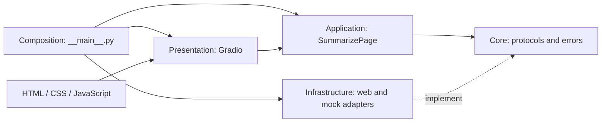

# Local Webpage Summarizer

A local Gradio app that loads one rendered HTTP(S) page through Playwright,
extracts readable text with Trafilatura, and streams a **mock demonstration**.
The mock does not produce meaningful summaries, use an LLM, or follow instructions
in webpage text. Its output is fixed demonstration text plus the source character count.

## Setup and use

Requires Python 3.12+ and uv. All Python dependencies live in `.venv`.

```sh
git clone https://github.com/ariobarxan/Summarizer.git
cd Summarizer
uv sync --locked
uv run playwright install chromium
uv run --locked python -c 'import sys; print(sys.executable)'
uv run --locked python -m summarizer
```

The app opens a browser and binds only `127.0.0.1:7860`, with Gradio sharing disabled.
Paste a URL and click Summarize. Status reports loading, extraction and mock streaming.
Cancel stops the active event; partial output is retained. New runs clear previous output.
The **Dark mode** switch at the top changes the entire palette. Your selection is saved in
this browser's local storage and restored on future visits to the same address and port.
On a first visit the app follows your system's light/dark preference. If browser storage is
blocked, switching still works for the current visit. Clearing site data resets the preference.
Fetching remote pages requires network access. Browser binaries use Playwright's own cache.
`uv.lock` is checked in; dependency changes require `uv sync` and review of the updated lock.

If port 7860 is already in use, stop the previous app with **Ctrl+C** in its terminal,
or launch on another port:

```sh
SUMMARIZER_PORT=7861 uv run --locked python -m summarizer
```

Open **http://127.0.0.1:7861** in that case. Keep the terminal running; **Ctrl+C** stops the
server. Use `SUMMARIZER_PORT`, rather than `GRADIO_SERVER_PORT`, because the application
passes its own configured port to Gradio. Restart the server after changing code or UI assets.

## Checks

```sh
uv sync --locked
uv run --locked pytest -q
uv run --locked ruff format --check src tests
uv run --locked ruff check src tests
uv run --locked mypy src tests
```

The suite requires installed Chromium, local socket binding, and browser process support.
It uses local HTTP fixtures, never public websites or LLMs. Browser smoke tests launch the
actual Gradio app and exercise extraction, streaming, completion, invalid input and cancellation.
They also check both system-theme defaults, keyboard theme switching, saved preference after
reload, mobile overflow, and switching when browser storage is denied.
Unit tests use independent substitutes to verify orchestration without starting Gradio or Chromium.
See PROGRESS.md for exact execution evidence, mutation checks, and independent review status.

## Architecture and decisions

```text
src/summarizer/
├── __main__.py           # Composition root and local server launch
├── config.py             # Validated environment settings
├── contracts.py          # Loader/extractor/summarizer protocols and errors
├── application.py        # URL validation, pipeline, stages and snapshots
├── adapters/
│   ├── web.py            # Playwright loading and Trafilatura extraction
│   └── mock.py           # Deterministic mock summarization stream
├── presentation.py       # Gradio components, events and status messages
├── ui_assets.py          # Loads bundled HTML, CSS and JS resources
├── ui_style.py           # Creates the Gradio base theme
└── assets/
    ├── styles.css        # Layout, palettes, responsive and focus styles
    ├── color_mode.js     # Theme switch and browser-local persistence
    └── templates/
        ├── appearance.html
        ├── hero.html
        ├── mock_notice.html
        ├── source_heading.html
        ├── output_heading.html
        └── footer.html
```

The module paths below are relative to `src/summarizer/`.

- `contracts.py`: framework-free loader, extractor, streaming provider Protocols and errors.
- `application.py`: URL validation and summarize-page orchestration; receives dependencies explicitly.
  Emits immutable `SummarizationSnapshot` objects containing a `Stage` enum and `output_text`;
  presentation translates stages into user-facing messages.
- `adapters/web.py`: resource-owning Playwright loading and Trafilatura extraction.
- `adapters/mock.py`: deterministic deltas, cooperative cancellation, optional injected failures.
- `presentation.py`: Gradio components, event/status mapping and retained partial output on failure.
- `ui_style.py`: constructs the Gradio base theme using local system fonts.
- `assets/templates/*.html`: static header, theme switch, notices, section headings and footer.
- `assets/styles.css`: light/dark palettes, responsive card layout and focus styling.
- `assets/color_mode.js`: browser-side theme switching and saved preference.
- `ui_assets.py`: loads trusted static assets into named constants via Python package resources;
  this works independently of the current directory, including from built wheels.
  Composition passes the CSS at launch using Gradio 6's theme/CSS API.
- `config.py`: validated environment settings; `__main__.py` constructs dependencies and launches.

Edit the HTML fragments to change static copy/markup, CSS to change appearance, and JavaScript
to change theme behavior. `presentation.py` keeps the Gradio components and event wiring.
These fragments contain no user-input substitution and need no template engine or extra server.

Dependency direction is presentation → application → contracts; concrete adapters implement contracts.
Only composition constructs concrete dependencies. Application tests demonstrate replaceability.



At runtime, `SummarizePage.stream()` validates the URL, awaits the loader's rendered HTML,
passes that HTML to the extractor, and consumes text deltas from the summarizer. It yields
immutable `SummarizationSnapshot` objects with a provider-neutral `Stage` and accumulated
`output_text`. `summarize_event()` translates these into output/status updates for Gradio.
Adapters own their resources and translate library failures into the shared application errors.
Application logic imports neither Gradio nor concrete adapters; dependencies are passed explicitly.

No database, separate API server, agent framework, or direct HTTPX dependency is added (Gradio has
its own transitive dependencies). Async generators fit Gradio's streaming events and Playwright's
async lifecycle. Extracting synchronously keeps the small local pipeline simple; large extraction
can block the event loop and is a future optimization. Each request owns its browser, avoiding
shared mutable browser state at the cost of startup overhead.

Streams yield nonempty **deltas**, not snapshots. The application accumulates snapshots for UI.
Streams expose `aclose()` and are closed on early termination. Cancellation normally propagates
unchanged; a known combined cleanup-failure exception is described under Limits below.
Adapters clean resources. Expected library failures become application errors with chained causes.
A failure after deltas leaves partial output visible and reports failure rather than completion.

Compatibility decisions were checked against installed Gradio 6.31.0, Playwright 1.64.1 and
Trafilatura 2.3.1. Gradio's async generator/event behavior is covered by the browser test;
[Gradio event docs](https://www.gradio.app/docs/gradio/blocks) document `cancels`.
[Playwright navigation docs](https://playwright.dev/python/docs/api/class-page#page-goto)
document bounded `domcontentloaded` navigation and the need to inspect HTTP status explicitly.

## Making UI changes

| Change | File to edit |
| --- | --- |
| Header, introduction or feature tags | `assets/templates/hero.html` |
| Theme switch markup or accessible label | `assets/templates/appearance.html` |
| Mock-mode notice | `assets/templates/mock_notice.html` |
| Source/output headings or footer copy | Corresponding HTML file in `assets/templates/` |
| Colors, spacing, borders, mobile layout or focus indicators | `assets/styles.css` |
| Theme preference loading, switching or saving | `assets/color_mode.js` |
| Gradio base theme and system font stack | `ui_style.py` |
| Inputs, buttons, component labels or event wiring | `presentation.py:create_ui()` |
| Progress messages and user-visible error handling | `presentation.py:summarize_event()` |

The HTML files are static fragments, not a full-page template: Gradio owns the page and its
interactive components. `ui_assets.py` reads the fragments using package resources and exposes
named constants, so component construction stays readable:

```python
from .ui_assets import HERO_HTML

gr.HTML(HERO_HTML, elem_id="hero")
```

CSS is passed to `launch(css=UI_CSS)` at the composition root; the theme-switch JavaScript is
attached through the appearance component's `js_on_load`. Theme preferences stay in the browser,
not in Python application state. Keep HTML IDs/classes consistent with CSS selectors and the
theme-switch script. Do not interpolate webpage text into the trusted HTML or JavaScript assets;
output belongs in the existing Gradio textbox.

After editing, restart the app, refresh the browser and check both modes and a narrow viewport.
For UI and theme regression checks, run:

```sh
uv run --locked pytest -q tests/test_presentation.py tests/test_browser_flow.py
```

## Configuration

| Environment variable | Default | Meaning |
| --- | --- | --- |
| `SUMMARIZER_PORT` | `7860` | Loopback port, 1–65535 |
| `SUMMARIZER_TIMEOUT_MS` | `15000` | Positive navigation timeout; optional selector gets its own same timeout |
| `SUMMARIZER_READY_SELECTOR` | unset | Optional CSS selector to wait for before extracting rendered HTML |
| `SUMMARIZER_MOCK_CHUNK_SIZE` | `12` | Positive characters per simulated delta |
| `SUMMARIZER_MOCK_DELAY` | `0.03` | Delay per delta, 0–60 seconds |

Programmatic `MockSummarizer(fail_after_chunks=N)` injects failure after N deltas for tests.
It is intentionally not an end-user setting. No hidden singleton application state is used.

## Adding a local LLM later

Implement `StreamingSummarizer.stream(source)` as an async generator of nonempty deltas;
translate provider-specific errors to `SummarizationError` with chained diagnostic causes.
Honor cancellation and close owned resources. Treat source as quoted/untrusted material separated
from trusted instructions. Wire the adapter in composition and update provider-specific UI labels.
Run the reusable `TestStreamingProviderContract` with appropriate normal, delayed and failure
factories; exact generated text need not match the mock. Replace loading/extraction similarly
through their small contracts. Different capabilities can require contract changes.

Model configuration, token budgeting, context-window detection, splitting, summary combination,
and model-specific prompt defenses are deferred requirements of a future real provider.
There is no real summary-quality verification in this version.

## Limits

DOM-ready does not mean every dynamic site has finished rendering; configure a readiness selector
for delayed content. No login automation, crawling, download/PDF support or public-site compatibility
promise is provided. HTTP(S) validation is syntax checking, not a network security boundary; redirects,
private network addresses and arbitrary browser subresources are allowed. Use this on trusted URLs
in a trusted local environment. Page size and extraction CPU/memory are not capped. Browser cleanup
is tested for normal, error and cooperative cancellation paths, not process crashes or repeated forced
cancellation. The Gradio queue is bounded to eight pending jobs and one active submission.

One known lifecycle defect remains: if navigation is cancelled and Playwright's browser cleanup
also raises an error, the cleanup error can mask cancellation as `PageLoadError`. See finding 2
in [REVIEW.md](REVIEW.md) for reproduction and suggested remediation. That review describes the
original frozen implementation; its mock-specific stage-label finding was addressed later by
the `Stage` enum and presentation-side message mapping recorded in [PROGRESS.md](PROGRESS.md).
